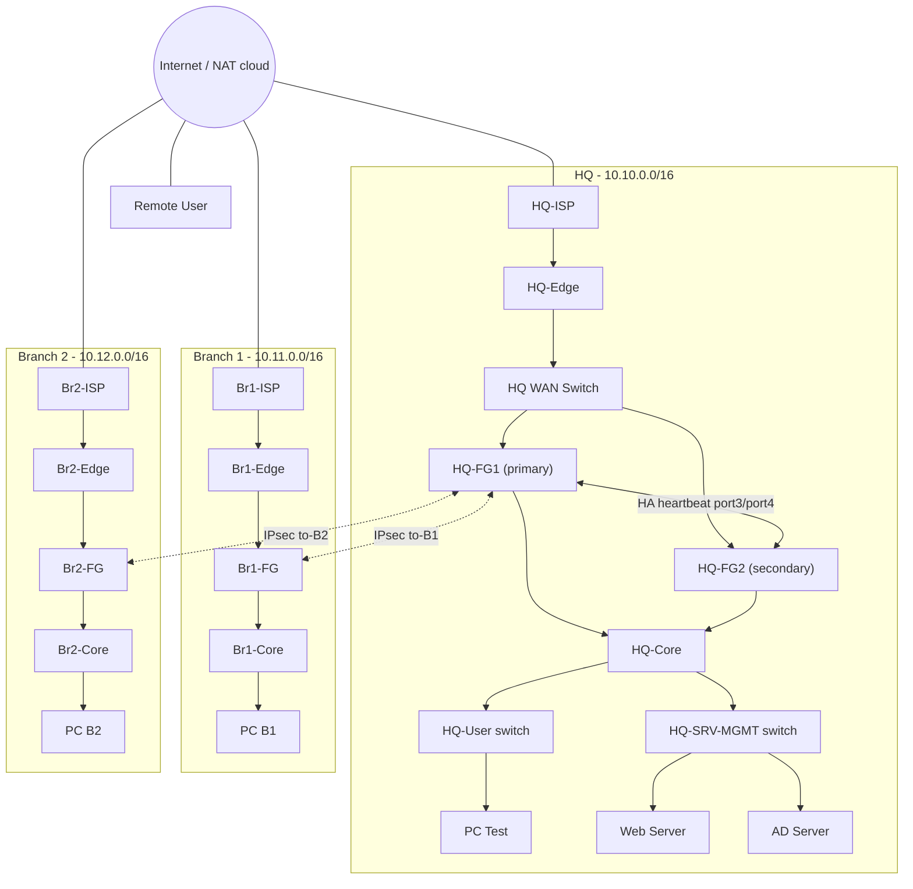

# Fortinet Capstone: Enterprise Network Security with FortiGate

A three-site enterprise network secured with **FortiGate firewalls**, designed and built in **PNETLab**. The lab has a headquarters with a high-availability firewall cluster, two branch offices connected by IPsec VPN, and a remote user connected by SSL-VPN.


---

## Table of contents

1. [Project overview](#1-project-overview)
2. [Team](#2-team)
3. [Architecture](#3-architecture)
4. [Technology stack](#4-technology-stack)
5. [IP addressing plan](#5-ip-addressing-plan)
6. [VLAN plan](#6-vlan-plan)
7. [Interface map](#7-interface-map)
8. [Implementation details](#8-implementation-details)
9. [Firewall policies](#9-firewall-policies)
10. [Requirements coverage](#10-requirements-coverage)
11. [Verification and test plan](#11-verification-and-test-plan)
12. [Troubleshooting log](#12-troubleshooting-log)
13. [Security notes and limitations](#13-security-notes-and-limitations)
14. [Future work](#14-future-work)
15. [How to reproduce the lab](#15-how-to-reproduce-the-lab)
16. [Repository structure](#16-repository-structure)
17. [Lessons learned](#17-lessons-learned)

---

## 1. Project overview

The goal is to design, configure and demonstrate a secure enterprise network that follows common best practices:

- Secure connectivity between sites
- Network segmentation
- High availability
- VPN communication (site-to-site and remote access)
- Clean routing and NAT
- Least-privilege firewall policies
- Threat inspection with security profiles
- Clear documentation

The network simulates a real organization with four parts:

| Part | Description |
|---|---|
| **Headquarters (HQ)** | Two FortiGates in an Active-Passive HA cluster, a core switch, access switches, four VLANs |
| **Branch 1** | One FortiGate, a core switch, local VLANs |
| **Branch 2** | One FortiGate, a core switch, local VLANs |
| **Remote user** | A client that connects through SSL-VPN |

Every site has an **ISP router** (simulating the Internet provider) and an **Edge router** in front of the firewall. This keeps the WAN simulation separate from the security boundary, like a real deployment.

---

## 2. Team

| Name | Role |
|---|---|
| Hamza Saeed Shukri | Team member |
| Salma Mohamed Ali | Team member |
| Ahmed Mohamed Zohry | Team member |
| Youssef Ahmed Hegazy | Team member |

Author profile: [github.com/hamzawy-s](https://github.com/hamzawy-s)

> Edit this table to show each person's actual role in the project.

---

## 3. Architecture

### Logical topology



### Design principles

- **Firewall as the router for every VLAN.** The core and access switches are Layer 2 only. All inter-VLAN traffic passes through firewall policies and is logged.
- **Hub-and-spoke VPN.** Both branches build a tunnel to HQ. Branch-to-branch traffic goes through HQ.
- **NAT exemption for tunnel endpoints.** The ISP routers do not translate traffic between the `10.100.x.x` WAN subnets, so the VPN peers reach each other with their real addresses.
- **Least privilege.** Allow rules name a source, a destination and specific services. A logged deny-all rule is last.
- **Controlled exposure.** Only one DMZ web service is published, through a VIP on one port.

---

## 4. Technology stack

| Component | Used for |
|---|---|
| PNETLab | Lab platform |
| FortiGate VM (FortiOS) | Firewalls, VPN, HA, security profiles |
| Cisco IOSv routers | ISP and Edge routers |
| Cisco IOSvL2 switches | Core, access and WAN switches |
| VPCS and server nodes | Test clients and servers |
| IPsec (IKEv2) | Site-to-site VPN |
| SSL-VPN | Remote access VPN |

---

## 5. IP addressing plan

### Site LAN blocks

| Site | LAN block |
|---|---|
| HQ | `10.10.0.0/16` |
| Branch 1 | `10.11.0.0/16` |
| Branch 2 | `10.12.0.0/16` |
| SSL-VPN client pool | `10.20.0.10` to `10.20.0.50` |

### WAN and ISP side

| Device | Interface | Connects to | Address |
|---|---|---|---|
| HQ-ISP | Gi0/1 | Net cloud | `10.0.137.x/24` (lab NAT segment) |
| HQ-ISP | Gi0/0 | HQ-Edge Gi0/0 | `203.0.113.1/30` |
| HQ-Edge | Gi0/0 | HQ-ISP | `203.0.113.2/30` |
| HQ-Edge | Gi0/1 | HQ WAN switch | `10.100.0.1/29` |
| HQ-FG1 / HQ-FG2 | port1 | HQ WAN switch | `10.100.0.2/29` (shared cluster address) |
| Br1-ISP | Gi0/1 | Net cloud | `10.0.137.x/24` |
| Br1-ISP | Gi0/0 | Br1-Edge | `203.0.113.5/30` |
| Br1-Edge | Gi0/0 | Br1-ISP | `203.0.113.6/30` |
| Br1-Edge | Gi0/1 | Br1-FG port1 | `10.100.1.1/29` |
| Br1-FG | port1 | Br1-Edge | `10.100.1.2/29` |
| Br2-ISP | Gi0/1 | Net cloud | `10.0.137.x/24` |
| Br2-ISP | Gi0/0 | Br2-Edge | `203.0.113.9/30` |
| Br2-Edge | Gi0/0 | Br2-ISP | `203.0.113.10/30` |
| Br2-Edge | Gi0/1 | Br2-FG port1 | `10.100.2.1/29` |
| Br2-FG | port1 | Br2-Edge | `10.100.2.2/29` |

The `203.0.113.0/24` range is reserved for documentation and is used only inside the lab. The Net-segment addresses come from the PNETLab NAT cloud. Use static addresses on the ISP routers, so routes do not break after a restart.

### Switch management addresses (VLAN 30)

| Switch | Address | Gateway |
|---|---|---|
| HQ-Core | `10.10.30.2/24` | `10.10.30.1` |
| HQ-User | `10.10.30.3/24` | `10.10.30.1` |
| HQ-SRV-MGMT | `10.10.30.4/24` | `10.10.30.1` |
| Br1-Core | `10.11.30.2/24` | `10.11.30.1` |
| Br2-Core | `10.12.30.2/24` | `10.12.30.1` |

### Hosts

| Host | Location | Address |
|---|---|---|
| PC Test | HQ VLAN 10 | DHCP `10.10.10.50` to `.200` |
| AD server | HQ VLAN 20 | `10.10.20.10/24` |
| Web server | HQ VLAN 80 (DMZ) | `10.10.80.10/24` |
| PC B1 | Branch 1 VLAN 10 | DHCP `10.11.10.50` to `.200` |
| PC B2 | Branch 2 VLAN 10 | DHCP `10.12.10.50` to `.200` |

---

## 6. VLAN plan

| Site | VLAN | Name | Network | Gateway | Addressing |
|---|---|---|---|---|---|
| HQ | 10 | Users | `10.10.10.0/24` | `10.10.10.1` | DHCP `.50` to `.200` |
| HQ | 20 | Servers | `10.10.20.0/24` | `10.10.20.1` | Static |
| HQ | 30 | Management | `10.10.30.0/24` | `10.10.30.1` | Static |
| HQ | 80 | DMZ | `10.10.80.0/24` | `10.10.80.1` | Static |
| Branch 1 | 10 | Users | `10.11.10.0/24` | `10.11.10.1` | DHCP `.50` to `.200` |
| Branch 1 | 20 | Servers | `10.11.20.0/24` | `10.11.20.1` | Static |
| Branch 1 | 30 | Management | `10.11.30.0/24` | `10.11.30.1` | Static |
| Branch 1 | 40 | Guest | `10.11.40.0/24` | `10.11.40.1` | No allow policy |
| Branch 1 | 50 | IoT | `10.11.50.0/24` | `10.11.50.1` | No allow policy |
| Branch 2 | 10 | Users | `10.12.10.0/24` | `10.12.10.1` | DHCP `.50` to `.200` |
| Branch 2 | 20 | Servers | `10.12.20.0/24` | `10.12.20.1` | Static |
| Branch 2 | 30 | Management | `10.12.30.0/24` | `10.12.30.1` | Static |

Each VLAN has its own subnet, is tagged, and reaches the FortiGate through a trunk on `port2`.

---

## 7. Interface map

| Device | Interface | Connects to | Role |
|---|---|---|---|
| HQ-FG1 / HQ-FG2 | port1 | HQ WAN switch | WAN |
| HQ-FG1 / HQ-FG2 | port2 | HQ-Core Gi0/0 and Gi0/1 | VLAN trunk |
| HQ-FG1 / HQ-FG2 | port3, port4 | Each other | HA heartbeat |
| HQ-FG1 / HQ-FG2 | port5 | MGMT cloud | Management |
| HQ-Core | Gi0/0, Gi0/1 | FG1 port2, FG2 port2 | Trunk |
| HQ-Core | Gi0/2, Gi0/3 | HQ-User, HQ-SRV-MGMT | Trunk |
| Br1-FG | port1 / port2 / port5 | Br1-Edge / Br1-Core / MGMT | WAN / trunk / management |
| Br2-FG | port1 / port2 / port5 | Br2-Edge / Br2-Core / MGMT | WAN / trunk / management |

---

## 8. Implementation details

### 8.1 ISP and Edge routers

- The **Edge routers** only route. Each has a default route to its ISP.
- The **ISP routers** do the NAT toward the Net cloud, and hold static routes to every site's FortiGate WAN subnet.
- The NAT access list denies `10.100.0.0/16` to `10.100.0.0/16` first, then permits the rest. This is the NAT exemption that keeps IKE traffic untranslated.

```
ip access-list extended NAT-OUT
 deny ip 10.100.0.0 0.0.255.255 10.100.0.0 0.0.255.255
 permit ip 10.100.0.0 0.0.255.255 any
ip nat inside source list NAT-OUT interface Gi0/1 overload
```

HQ-ISP also holds static NAT entries for the published services (SSL-VPN on `10443`, web VIP on `8080`).

### 8.2 High availability (HQ)

| Setting | HQ-FG1 | HQ-FG2 |
|---|---|---|
| Mode | Active-Passive | Active-Passive |
| Group name | `HQ-HA` | `HQ-HA` |
| Priority | 200 (primary) | 100 (secondary) |
| Heartbeat interfaces | port3 (100), port4 (50) | port3 (100), port4 (50) |
| Monitored interfaces | port1, port2 | port1, port2 |
| Session pickup | Enabled | Enabled |
| Management interface | port5, own address | port5, own address |

Configuration is made on the primary and synchronized to the secondary. The dedicated management interface lets you reach each unit separately.

### 8.3 Segmentation and DHCP

- VLAN interfaces are created on `port2` of the FortiGate. The firewall is the default gateway for every VLAN.
- DHCP is enabled on the Users VLAN at HQ and at each branch.
- The Management VLAN is reachable only by policy from the Management VLAN itself.

### 8.4 IPsec site-to-site VPN

| Setting | Value |
|---|---|
| Topology | Hub-and-spoke, HQ is the hub |
| Tunnels | HQ to Branch 1, HQ to Branch 2 |
| IKE version | 2 |
| Authentication | Pre-shared key |
| Peer addresses | `10.100.0.2`, `10.100.1.2`, `10.100.2.2` |
| Phase 2 selectors | `0.0.0.0/0` to `0.0.0.0/0` |
| Proposals (lab) | Phase 1 `des-md5`, phase 2 `des-md5 des-sha1` |

The broad phase 2 selectors let Branch 1 reach Branch 2 through HQ. The static routes and the firewall policies decide what is actually allowed.

Static routes for the tunnels:

| Device | Destination | Interface |
|---|---|---|
| HQ-FG | `10.11.0.0/16` | `to-B1` |
| HQ-FG | `10.12.0.0/16` | `to-B2` |
| Br1-FG | `10.10.0.0/16`, `10.12.0.0/16` | `Br1-to-HQ` |
| Br2-FG | `10.10.0.0/16`, `10.11.0.0/16` | `Br2-to-HQ` |

> The pre-shared keys are not stored in this repository. Use your own strong keys.

### 8.5 NAT and published services

| Item | Value |
|---|---|
| Outbound NAT | Enabled on LAN to WAN policies |
| VIP name | `Web-VIP` |
| External port | `8080` on the HQ WAN address |
| Mapped to | DMZ web server `10.10.80.10`, port `80` |
| NAT on VPN policies | Disabled |

### 8.6 Security profiles

| Profile | Configuration |
|---|---|
| Antivirus | Scans HTTP, FTP, SMTP, POP3 and IMAP. Action: block. Test file: EICAR |
| Web filter | Static URL filter blocks `*.blocked-test.com`. Risky categories can be added when FortiGuard is available |
| IPS | Built-in `default` sensor |
| Application control | Blocks P2P and Proxy categories |
| SSL inspection | `certificate-inspection` |

Profiles are applied to LAN-to-WAN policies and to VPN policies.

### 8.7 Remote access VPN

| Setting | Value |
|---|---|
| Type | SSL-VPN |
| Port | `10443` on the HQ WAN interface |
| Users | Local user in the group `SSL-VPN-Users` |
| Client address range | `10.20.0.10` to `10.20.0.50` |
| Access | HQ servers only, with HTTP, HTTPS, SMB and ping |

SSL-VPN is removed in FortiOS 7.6.3 and later. On those versions, use an IPsec dial-up tunnel with FortiClient.

---

## 9. Firewall policies

### HQ

| # | Name | From | To | Service | NAT | Profiles |
|---|---|---|---|---|---|---|
| 1 | Users-to-Servers | Users | Servers | DNS, HTTP, HTTPS, SMB, PING | Off | IPS, AppCtrl |
| 2 | Users-to-DMZ | Users | DMZ | HTTP, HTTPS, PING | Off | IPS |
| 3 | Mgmt-to-All | Management | Users, Servers, DMZ | ALL | Off | None |
| 4 | Users-to-Internet | Users | WAN | ALL | On | AV, Web, IPS, App |
| 5 | Servers-to-Internet | Servers | WAN | DNS, HTTP, HTTPS, NTP | On | AV, Web, IPS, App |
| 6 | Internet-to-Web | WAN | DMZ (`Web-VIP`) | ALL (limited by the VIP) | Off | IPS |
| 7 | HQ-to-Branches | Users, Servers | `to-B1`, `to-B2` | ALL | Off | AV, Web, IPS, App |
| 8 | Branches-to-HQ | `to-B1`, `to-B2` | Users, Servers | ALL | Off | AV, Web, IPS, App |
| 9 | Branch1-to-Branch2 | `to-B1` | `to-B2` | ALL | Off | AV, Web, IPS, App |
| 10 | Branch2-to-Branch1 | `to-B2` | `to-B1` | ALL | Off | AV, Web, IPS, App |
| 11 | SSLVPN-to-Servers | `ssl.root` | Servers | HTTP, HTTPS, SMB, PING | Off | AV, IPS |
| 12 | Deny-All-Log | Any | Any | ALL | Off | Deny, log all |

Branch and VPN users cannot reach the HQ Management VLAN, because no allow policy exists for it.

### Branches (same structure at both sites)

| # | Name | From | To | NAT | Profiles |
|---|---|---|---|---|---|
| 1 | Users-to-Servers | Users | Servers | Off | IPS |
| 2 | Users-to-Internet | Users | WAN | On | AV, Web, IPS, App |
| 3 | Servers-to-Internet | Servers | WAN | On | AV, Web, IPS, App |
| 4 | LAN-to-VPN | Users, Servers | Tunnel to HQ | Off | AV, Web, IPS, App |
| 5 | VPN-to-LAN | Tunnel to HQ | Users, Servers | Off | AV, Web, IPS, App |
| 6 | Deny-All-Log | Any | Any | Off | Deny, log all |

---

## 10. Requirements coverage

### Mandatory requirements

| Requirement | Implementation | Section |
|---|---|---|
| HQ, Branch 1, Branch 2 and remote user | Four parts, each with ISP and Edge routers | 3 |
| VLANs at HQ (Users, Servers, Management) | Plus a DMZ VLAN | 6 |
| Inter-VLAN routing on the FortiGate | VLAN interfaces on `port2` | 8.3 |
| DHCP for the Users VLAN | HQ and both branches | 8.3 |
| HA Active-Passive with heartbeat and sync | FG1 and FG2 | 8.2 |
| Branch VLANs and local routing | Users and Servers at each branch | 6, 8.3 |
| IPsec HQ to Branch 1 and Branch 2 | IKEv2, hub-and-spoke | 8.4 |
| Branch-to-branch through HQ | Broad selectors, routes and policies | 8.4 |
| Firewall policies, LAN to WAN with NAT | Policies 4 and 5 (HQ) | 9 |
| VPN policies with inspection | Policies 7 to 10 (HQ) | 9 |
| Inter-VLAN policies, least privilege | Policies 1 to 3 | 9 |
| Outbound NAT and a VIP | `Web-VIP` on port `8080` | 8.5 |
| Static routes, default route, VPN routes | All devices | 8.4 |
| Security profiles (AV, Web, IPS, App) | On LAN-to-WAN and VPN policies | 8.6 |
| Remote access VPN with authentication | SSL-VPN, local user group | 8.7 |
| Documentation | This README and the PDF | 16 |

### Bonus requirements

None of the bonus items are implemented yet. See [Future work](#14-future-work).

---

## 11. Verification and test plan

Use this checklist and keep a screenshot for each item. Replace `[ ]` with `[x]` when a test passes.

| Status | Test | How to check |
|---|---|---|
| [ ] | DHCP on each Users VLAN | On the PC: `ip dhcp`, then ping the gateway |
| [ ] | Internet access from each site | `ping 8.8.8.8` from every PC |
| [ ] | Both tunnels up | **Monitor > IPsec Monitor**, or `get vpn ipsec tunnel summary` |
| [ ] | Branch to HQ | From a branch PC, ping `10.10.20.10` |
| [ ] | Branch to branch | From the Branch 1 PC, ping the Branch 2 PC |
| [ ] | Antivirus blocks EICAR | Download the EICAR test file, check **Security Events** |
| [ ] | Web filter blocks a URL | Browse to a `*.blocked-test.com` address |
| [ ] | Application control blocks P2P | Try a torrent client, check the logs |
| [ ] | NAT and VIP | From the remote user, open `http://<HQ-ISP Net address>:8080` |
| [ ] | SSL-VPN login | Connect as the VPN user, then reach an HQ server |
| [ ] | HA failover | Run `ping 8.8.8.8 -t` from an HQ PC, stop FG1, expect 1 to 3 lost pings |
| [ ] | HA sync | After failover, check `get system ha status` shows both units in sync |

Useful verification commands:

```
# Cisco
show ip interface brief
show ip route static
show ip nat translations

# FortiGate
get system ha status
get vpn ipsec tunnel summary
get router info routing-table all
diagnose debug application ike -1
execute ping <address>
```

---

## 12. Troubleshooting log

Real problems found during the build, with the fix for each.

| # | Problem | Cause | Fix |
|---|---|---|---|
| 1 | Cisco interfaces `administratively down` after a restart | The saved configuration did not include `no shutdown` | Add `no shutdown` and run `write memory` |
| 2 | Routes to a branch stopped working | The ISP Net addresses came from DHCP and changed after a restart | Use static addresses on the ISP Net interfaces |
| 3 | The FortiGate pinged its gateway but not the other site | port5 used DHCP and installed a default route that beat the static default route | `set defaultgw disable` on port5 |
| 4 | `set defaultgw disable` gave a parse error | port5 was still in static mode | Set `mode dhcp` first, then the option |
| 5 | Management port5 had no address after HA was enabled | HA management reservation changed how port5 behaves | Give port5 a static address and an HA management gateway |
| 6 | Remote FortiGate did not answer ping | PING was not enabled on port1 | Enable `allowaccess ping` on port1 |
| 7 | A branch FortiGate showed the default hostname and no config | The unit was still in factory state | Configure the interfaces and routes step by step |
| 8 | `set proposal aes256-sha256` failed | The VM only offered `des-*` proposals | Match HQ exactly with `des-md5` and `des-md5 des-sha1` |
| 9 | Ping from an Edge router to a branch address failed | The ping used an address the branch ISP could not route back to | Ping with `source` set to the Edge router's FortiGate-facing address |
| 10 | Config lines cut off when pasting into the console | Long pastes overflowed the console buffer | Paste in small blocks and check with `show running-config` |

Recommended troubleshooting order: underlay reachability, then IKE negotiation, then routing, then firewall policy.

---

## 13. Security notes and limitations

- **Weak lab crypto.** The FortiGate VMs offered only DES proposals, so the tunnels use DES with MD5 in this lab. This is not secure. Production must use AES-256 with SHA-256, strong DH groups and strong keys or certificates.
- **Simple lab credentials.** The lab used simple keys and passwords for speed. Never reuse them. This repository contains no keys or passwords.
- **No FortiGuard licence assumed.** Web filter categories, IPS updates and application signatures may need a licence. The static URL filter and the EICAR test work without it.
- **Lab-only address ranges.** `203.0.113.0/24` is a documentation range and is used only inside the lab.
- **Single points of failure.** Each branch has one firewall and one ISP, and HQ has one Internet path.

---

## 14. Future work

These items are **not built yet**. They are good next steps:

| Idea | What it adds |
|---|---|
| SD-WAN | Multiple ISP links, traffic steering and SLA monitoring |
| DNS filtering | Domain blocking with a DNS security profile |
| DoS policy | Protection against floods, with detection tests |
| Certificates and PKI | Certificate-based authentication and HTTPS inspection |
| Security Fabric | Device visibility and centralized monitoring |
| Logging server | FortiAnalyzer or a Syslog server |
| Automation stitches | Alerts for VPN down, HA failover and IPS events |
| Advanced application control | Block named apps and use category filtering |
| Server hardening | Restricted source addresses and limited open ports on the VIP |
| Advanced routing | OSPF or BGP instead of static routes |
| Other ideas | Geo-blocking, micro-segmentation, NAC, MFA and threat-intelligence feeds |

---

## 15. How to reproduce the lab

1. **Build the topology in PNETLab.** Add the nodes from the interface map, and connect the Net cloud and the MGMT cloud.
2. **Configure the Cisco devices.** Start with the ISP routers, then the Edge routers, then the switches. Save each configuration with `write memory`.
3. **Check the underlay.** Every FortiGate must reach its own Edge router and the other sites' WAN addresses.
4. **Configure HA at HQ.** Set up both units, then confirm they are in sync before any other change.
5. **Configure HQ on the primary.** Interfaces, DHCP, addresses, security profiles, tunnels, routes, VIP, SSL-VPN and policies.
6. **Configure each branch.** Hostname, interfaces, DHCP, tunnel, routes, security profiles and policies.
7. **Bring up the tunnels.** Ping across each tunnel and check the IPsec monitor.
8. **Run the test plan** in section 11 and keep screenshots.

---

## 16. Lessons learned

- A clear IP plan and segmentation make everything else easier.
- Both ends of a VPN must match exactly: proposals, keys and selectors.
- A tunnel can be "up" and still pass no traffic if routes or policies are missing.
- A DHCP-enabled management interface can add an unwanted default route.
- Infrastructure should use static addresses and saved configurations.
- Troubleshoot in layers: underlay, IKE, routing, then policy.
- A working configuration is not the same as a secure and resilient design.

---

